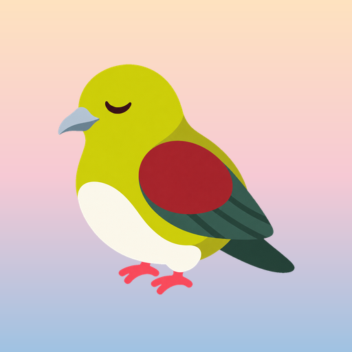

# QuartzLamp

[中文](README.md) · **English**

<picture>
  <source media="(prefers-color-scheme: dark)" srcset="docs/img/icon_dark.png">
  
</picture>

An unofficial Material 3 Expressive Android controller for the Lenze Tech
sound-reactive lamp ("拾音灯"), rebuilt from scratch.

> **Status**: [v0.5.7](https://github.com/deserthouse/quartzlamp/releases/tag/v0.5.7) (versionCode 16, 2026-10-24; see [CHANGELOG](CHANGELOG.md)); emulator and protocol layers verified — real-lamp acceptance progress and boundaries per `project_status.md` §7 and `docs/acceptance.md`. Supported hardware: the Lenze Tech sound-reactive lamp (Bluetooth BLE). Building from source below.

[Build from source](#build) · [Hardware acceptance notes](docs/acceptance.md) · [Changelog](CHANGELOG.md)

## Features (three tabs: Device / Effects / Timer)

- **Device**: power as the primary action + brightness (a global parameter — applies in
  both static-color and effect modes) + connection management (multi-lamp, per-device
  connect/disconnect/reconnect; auto-reconnect after unexpected drops — 3 rounds, 4s
  apart, cancellable at any time; fixed on `main`, real-lamp re-verification pending;
  manual disconnects never fight back) + lamp pickup configuration (four pickup styles
  and sensitivity for the lamp's own microphone)
- **Effects**: `Static | Dynamic` segmented toggle, applied exclusively —
  Static = hue wheel + 8 presets (BC04 static color); Dynamic = 153 built-in effects
  (9 categories × 17) with original names, name-color hint bars, speed/sensitivity
- **Timer**: weekly on/off schedules (two hardware slots), stored on the lamp and
  readable back (no "enable" switch — the protocol has no such bit; saving sends
  immediately, reading an "unset" slot clears it)
- Top-bar ⚙️: quartz / dynamic-color theme toggle, about & declarations

## Technical Highlights

- Kotlin + Compose + Material 3 Expressive (material3 1.5.0-alpha22 line)
- BLE: FastBle 2.3.4 vendored as source (`app/libs-src/`, Apache-2.0, see `third_party/`) —
  the same transport the vendor app uses; frame table at `docs/ble_protocol.md`
  (14 frames, extracted from disassembly and locked by unit tests)
- minSdk 31 / targetSdk 37 · single `:app` module, no DI · emulators auto-switch to a
  fake lamp (`FakeLampConnection`) for development without hardware
- The repo also contains a **Windows client port in progress** (`windows/`): the protocol
  library, GATT queue and session layer are ported with unit tests
  (`dotnet test windows/tests/QuartzLamp.Tests`); there is no usable UI yet and it is
  unreleased — the Android app remains the current deliverable

## Build

```bash
./gradlew assembleDebug    # requires JDK 21 (AGP 9 hard requirement; system JDK 11 fails)
./gradlew testDebugUnitTest
```

Release signing reads `~/.gradle/gradle.properties` (four `QUARTZLAMP_*` keys);
**the build fails explicitly if they are missing (no debug-signing fallback)**.

## Docs

- `docs/ble_protocol.md` — BLE protocol frame table (single source of truth)
- `docs/acceptance.md` — acceptance checklist (emulator-verified + on-device + protocol arbitrations)
- `project_status.md` — project status (Chinese)

## Declaration

- This is an independent reimplementation of a controller for personally owned hardware, for learning and personal use. Not affiliated with Lenze Tech; no vendor code or assets reused. Effect names are functional descriptive phrases.
- Provided as-is, without warranty of any kind; use at your own risk. BLE commands target this lamp hardware only.

> 中文声明见 [README.md](README.md)。

---

## AI disclosure

This project contains no human ingredients. AI (ZCode / GLM) assisted with development. The maintainer defines requirements and reviews the result.

## About the Name

The Chinese name 拾音灯 ("sound-picking lamp") says what it does. The English name
QuartzLamp embraces the pun hidden in the vendor's package name `quartzlamp`:
拾音 (shíyīn, "to pick up sound") ≈ 石英 (shíyīng, "quartz"). Hence — a lamp that
listens, named after a rock it is not.
